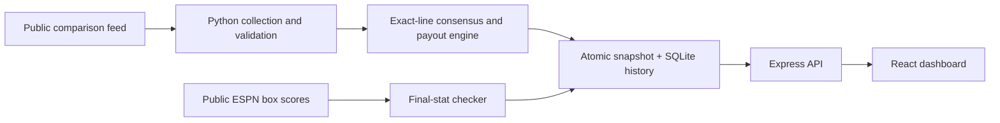

# PropShop

**A sports-prop research dashboard with multi-book pricing, exact-line comparisons, and a complete Power/Flex valuation engine.**

Compare reported PrizePicks lines with prices from **eight sportsbooks**, inspect the market's no-vig probabilities, and rank conditional edges across NBA, NFL, MLB and NHL. PropShop combines a concurrent Python collection pipeline, an Express API and a responsive React interface. You can check the actual PrizePicks line, model a custom payout schedule, and review saved estimates against final box scores from one local workspace.

## Highlights

- **Multi-book consensus:** FanDuel, DraftKings, BetMGM, Caesars, bet365, BetRivers, Hard Rock and Fanatics. The engine uses the median probability across eligible books at the exact same line.
- **Complete entry math:** ten standard Power/Flex schedules, including partial Flex returns, plus a custom payout editor that recalculates break-even rates and hypothetical entry ROI.
- **Line validation:** record the line and projection type you see in PrizePicks. Known mismatches, modified projections and expired checks leave the ranked board until you recheck them.
- **Persistent research history:** SQLite preserves the first positive estimate at each line/direction and archives collection snapshots. The final-stat checker separates hypothetical wins/losses from pending or unresolved observations.
- **Operational controls:** a collection time budget, request pacing, process locks, atomic snapshots, structured failure diagnostics and stale/started-event filtering.
- **A local-first workflow:** run the default public collector without account credentials, browser cookies or an API key.

### Measured live collection

An October 20, 2026 run retrieved **274 reported PrizePicks lines and 1,270 sportsbook quotes**, yielding **196 exact-line comparisons** across NBA and NHL. The source covered eight sportsbooks. This run completed 60 of 101 planned market requests within the 90-second budget; 41 requests recorded network/deadline warnings, so these figures describe partial coverage at that moment. They measure collection capacity, not prediction accuracy or profit. An earlier October 19 run produced 98 comparisons across NFL, NHL and MLB.

## Architecture



## Quick start

Use **Python 3.9+**, **Node 20+**, Git, and macOS or Linux. Windows users can use a Linux environment such as WSL; native Windows and WSL have not been validated. The default collector uses the Python standard library.

```bash
git clone https://github.com/nikhiltrip/propshop.git
cd propshop
npm ci --prefix server
npm ci --prefix client
npm run build --prefix client
PORT=3011 node server/server.js
```

Open **http://localhost:3011** and select **Collect fresh lines**. The API serves the production React build and binds to loopback. For frontend development, start the API on port 3001 and run `npm start --prefix client`; the development proxy uses port 3001.

A clean-dependency smoke test on macOS with Python 3.9.6 and Node 23.11.0 installed the server and client from their lockfiles and built the UI without reusing the repository's inherited `node_modules`. This validates setup on that machine; other operating systems and networks still need independent testing.

## Using the dashboard

1. **Collect and filter.** Browse all accepted comparisons, or narrow by player, sport, stat, minimum edge or positive edges only.
2. **Inspect the evidence.** Expand **Sportsbook quotes** for each contributing book's over/under prices. Single-book estimates have less independent market evidence.
3. **Check the line.** Expand **Feed line only · check it**, enter the current line and projection type from the same PrizePicks game, and save your observation. A matching standard line receives a 15-minute user-confirmed label. Mismatches, modifiers and expired checks move to Coverage, where you can recheck them. This records your observation; it does not connect to your account or certify its payout.
4. **Check the entry payout.** Inspect every hit-count return in the standard schedule or enter the complete schedule shown for your actual entry. Custom entries change model thresholds and ROI, not sportsbook probabilities.
5. **Review history.** **Saved estimates and results** preserves the first positive estimate at each line and direction. Select **Check final stats** to match games by team identity and scheduled start time and inspect public box-score outcomes.

The summary's **Above model break-even** count uses the best standard entry model. The comparison table uses your selected standard/custom model, so its visible count can differ. All accepted comparisons appear by default; **Positive edge only** is optional.

## Collection and data sources

The default collector uses the public [ScoresAndOdds Odds Compare feed](https://www.scoresandodds.com/nfl/props), which reports PrizePicks main lines and sportsbook prices. It reads supported categories from the source's current menus, discovers today/tomorrow schedules, and considers upcoming games within 48 hours. The event budget gives each available league a turn before allocating additional games. Categories with no source lines remain visible in coverage diagnostics.

Requests use three workers with at least 350 ms between starts. `--timeout` limits the public collection budget (default 90 seconds); each request has a maximum 10-second socket timeout. Queued requests stop after the budget or an access denial. Requests already in flight may finish. Partial collections retain request-level warnings. HTTP 401/403/429 and schema/identity failures preserve the previous snapshot with structured error details. Clean empty source results publish an empty board with a reason, instead of masquerading as a network failure.

```bash
python3 daily_scraper.py
python3 daily_scraper.py --sports NBA,NHL --max-events 10 --timeout 90
python3 results.py refresh
```

Configuration uses exported environment variables; the app does not load `.env` automatically.

| Variable | Purpose |
| --- | --- |
| `PROPSHOP_SOURCE=public` | Public comparison feed (default); `browser` selects optional direct adapters |
| `PROPSHOP_SPORTS=NBA,NFL,MLB,NHL` | Leagues to collect |
| `PYTHON=/absolute/path/to/python` | Interpreter override; otherwise `.venv/bin/python`, then `python3` |
| `PROPSHOP_DATA_DIR=/absolute/path` | Snapshots, SQLite history, line checks, status and audit reports |
| `PORT=3011` | API/static dashboard port (default 3001) |

`--max-events` limits total upcoming games (1–100, default 20). Snapshots and manual line confirmations expire after 15 minutes; started events leave the active board. Collection and final-stat updates run on demand. Polling local API state does not fetch external prices. These setup commands install no recurring scheduler.

## How the calculations work

For each eligible sportsbook at the exact PrizePicks line, convert both American prices to implied probabilities and normalize the pair:

```text
no_vig_over = implied_over / (implied_over + implied_under)
no_vig_under = 1 - no_vig_over
consensus_over = median(no_vig_over across eligible books)
consensus_under = 1 - consensus_over
edge (percentage points) = consensus side percentage - entry-model break-even percentage
illustrative entry ROI = expected total return for equal, independent legs - 1
```

The public path requires matching league, normalized player, explicit stat alias, numeric line, full-game period, start time and provider event identity. Ambiguous duplicates and incomplete prices fail validation. Integer lines require tie modeling and remain outside ranked comparisons. The engine does not interpolate odds from different lines.

Market probabilities are estimates derived from offered prices. Entry ROI describes a hypothetical full entry with equally likely, independent legs. Actual entry eligibility, correlations, account-specific offers and settlement can change the result.

## History and final-stat checks

`history.sqlite` stores complete collection snapshots and immutable first-positive observations keyed by market line and direction. Refreshes add observations without rewriting the original estimate. The API exposes the 200 most recent positive estimates; the database retains the underlying history.

The result checker uses public ESPN scoreboards and box scores. It requires a unique team-and-time game match, an exact normalized athlete name and an applicable stat. It records a hypothetical win/loss only after the source marks the game final. Missing players, ambiguous matches, unsupported stat categories and unclear participation remain **Needs review**; missing data does not become zero. Use `python3 results.py refresh --recheck-final` to revisit completed outcomes after a stat-provider correction.

The initial grading covers supported NBA box-score totals/combinations, NHL goals/assists/points/shots/blocks/saves, selected NFL passing/rushing/receiving/kicking stats, and selected MLB batting/pitching stats. Some collected markets, such as NFL longest completion and MLB total bases, lack a supported grading field and remain unresolved. Records imported after the game carry a **reconstructed** label and do not enter prospective counts. These are research outcomes against the saved feed line, not actual bets, verified PrizePicks settlements, a profit calculation or independent portfolio trials.

### Verified PrizePicks payout schedules

**Last manually verified: October 19, 2026 (America/Los_Angeles).** Official references: [Payouts](https://www.prizepicks.com/help-center/payouts) and [Potential Outcomes](https://www.prizepicks.com/help-center/potential-outcomes); both pages displayed an October 19, 2026 update date when checked.

The following table is the **standard Player Picks minimum-guarantee schedule** modeled in `analysis.PAYOUTS`. All omitted hit counts return 0x. Multipliers describe total returned relative to the entry fee: a $10 entry returning 3x pays $30 total ($20 net profit); 1x returns the entry fee, and 0.4x returns $4 ($6 net loss).

| Entry model | Payout by number of correct picks | Equal-leg break-even probability |
| --- | --- | ---: |
| 2-Pick Power | 2/2: 3x | 57.7350% |
| 3-Pick Power | 3/3: 6x | 55.0321% |
| 4-Pick Power | 4/4: 10x | 56.2341% |
| 5-Pick Power | 5/5: 20x | 54.9280% |
| 6-Pick Power | 6/6: 37.5x | 54.6590% |
| 2-Pick Flex | 2/2: 2x; 1/2: 0.5x | 61.8034% |
| 3-Pick Flex | 3/3: 3x; 2/3: 1x | 57.7350% |
| 4-Pick Flex | 4/4: 6x; 3/4: 1.5x | 55.0321% |
| 5-Pick Flex | 5/5: 10x; 4/5: 2x; 3/5: 0.4x | 54.2525% |
| 6-Pick Flex | 6/6: 25x; 5/6: 2x; 4/6: 0.4x | 54.2060% |

**These probabilities are calculated by PropShop, not quoted by PrizePicks.** They solve `expected total return = 1` assuming every leg has the same win probability, legs are independent, and only the listed payout schedule applies. They are not a player's hit rate or a price offered on an individual prop. Figures are rounded for display; the engine uses the calculated unrounded thresholds.

For Power, `p = multiplier ** (-1 / pick_count)`. For Flex, PropShop includes every outcome in `sum(C(n,k) * p**k * (1-p)**(n-k) * payout[k]) = 1`. Looking only at Flex's all-hit multiplier produces the wrong threshold.

### Check your actual entry payout in the dashboard

Expand **Check the payout behind your edge estimate** to inspect every outcome of the selected model, including partial Flex returns and zero returns. The API exposes the standard schedule's manual verification date and source. Projection type does not verify an account's payout: collected rows remain `payout_verified: false`, including directly collected standard projections.

If the actual PrizePicks entry differs, select **Enter the payout shown for my entry**, copy total-return multipliers for every correct-pick count, and confirm that you copied the complete schedule. A $10 entry returning $30 total uses 3x. The dashboard recalculates equal-leg break-even, edge and illustrative entry ROI from that schedule; sportsbook percentages stay unchanged. Incomplete, invalid or unconfirmed custom schedules hide estimates. Returns must be nonnegative and nondecreasing with correct picks, with the all-hit return above 1x and zero-hit return below 1x. Nonmonotone promotions and schedules outside these constraints are unsupported.

This is a user-confirmed calculation, not an account connection or independent verification. It does not verify that the displayed players can be combined into the actual entry, or account for correlations, DNPs, ties, fees or leaderboard awards. The form applies one hypothetical schedule to the board for comparison. Values remain only in the current page session, reset when switching entry model or reloading, and are never sent to the server. The summary's positive count continues to use published standard models; custom values affect the comparison table only.

### When the standard table does not apply

PrizePicks' [Payouts explanation](https://www.prizepicks.com/help-center/payouts) says entry-specific amounts can differ because of promotions, bonus lineups, pick combinations, special projections, mixed Player/Team entries, and other disclosed factors. DNPs, Reboots and ties can also change settlement. **The payout schedule displayed for the actual entry controls; this table does not verify account-specific eligibility or payout.**

[Demons and Goblins](https://www.prizepicks.com/demons-and-goblins) can alter payouts in either direction. Do not reuse a standard threshold for a modified entry without its complete payout schedule. The public odds feed does not certify projection modifiers.

[Leaderboard winnings](https://www.prizepicks.com/help-center/potential-outcomes) are separate from the modeled minimum guarantee: the published standard six-pick leaderboard amounts are 25x Power and 12.5x Flex, versus the minimum-guarantee all-hit amounts of 37.5x and 25x above. Leaderboard ties can split prizes; eligible awards use the higher amount, not their sum. PropShop does not estimate leaderboard returns.

### Keeping the numbers current

Payout verification is manual. **Collect fresh lines refreshes source lines and sportsbook prices; it does not recheck PrizePicks' payout rules.**

When a published standard schedule changes:

1. Recheck both official sources above and the actual product/entry details; record the verification date and applicable schedule in this README and `analysis.PAYOUT_VERIFIED_AT`.
2. Update the complete hit-count mapping in `analysis.PAYOUTS`, including partial Flex returns. Do not change only the top multiplier or paste a rounded break-even percentage.
3. Recalculate the README table from `analysis.BET_TYPES`. `threshold()` derives break-even probabilities from the full mapping.
4. Run `python3 -m unittest discover -s tests -v`, then collect a new snapshot. Saved snapshots contain their calculated models; reading an old snapshot does not recalculate it after a payout-code change.

This review confirmed the existing modeled schedules; no payout constant needed changing on October 19, 2026.

## Reliability, access and validation

The default public path avoids the direct PrizePicks/FanDuel login and CAPTCHA flow. Each user runs the local setup with their own network; they do not need your credentials or browser profile. The source remains an undocumented third-party endpoint: access, schema, coverage and latency can change. A supported provider integration would be needed to reduce this dependency for a broader distribution.

A refreshed PrizePicks board on October 19 showed McCaffrey rushing yards at 62.5 while a fresh comparison request reported 63.5. The manual-check workflow now suppresses known discrepancies from ranking. Unchecked feed lines remain conditional estimates, and no account-specific payout receives an automatic verified label. A fresh retrieval time also does not certify a fresh sportsbook quote; feed-record timestamps can lag.

```bash
python3 -m unittest discover -s tests -v
node --test server/server.test.js server/line-checks.test.js
CI=true npm test --prefix client -- --watchAll=false --runInBand
npm run build --prefix client
python3 validate_snapshot.py
```

**51 automated tests pass** (30 Python, six API/line-check tests and 15 React/math tests). The production build and clean-dependency setup smoke test also pass. Tests cover exact matching, odds and payout math, source identity, request deadlines/access denials, empty versus failed collection, diagnostic preservation, immutable history, final-only grading, missing-player handling, line quarantine, model switching and UI states. Tests use synthetic fixtures; live collection, snapshot audits and clean-install checks provide separate integration evidence.

The audit tool makes no network requests and leaves dashboard data unchanged. It recalculates no-vig consensus, checks timestamps and duplicate evidence, and reports old feed-record timestamps separately. Reports under `data/validation/` count distinct Pacific collection dates rather than repeated audits of one snapshot. Successful audited collections have now been observed on October 19 and October 20; this does not establish long-term accuracy or access from other networks.

Optional direct line checks use `python3 validate_snapshot.py --checks /path/to/checks.json`. The local file contains an array of public observations with `sport`, `player`, `stat` (feed label), `start_time`, `line`, `observed_at` and `board_refreshed: true`. Observations over five minutes apart remain unverified. The audit file and the dashboard's line-check registry are separate workflows. Do not count a retained snapshot after a failed collection as a new successful day.

### Optional direct browser adapters

The default public path needs no browser. The older direct PrizePicks/FanDuel adapters use ordinary Playwright and remain experimental; source restrictions blocked end-to-end verification.

```bash
python3 -m venv .venv
.venv/bin/python -m pip install -r requirements.txt
.venv/bin/python -m playwright install chromium
.venv/bin/python daily_scraper.py --source browser --headed --timeout 300
```

The dedicated ignored profile defaults to `data/browser-profile/`; `PROPSHOP_PROFILE_DIR` overrides it. Complete login/verification yourself. Keep session cookies private. The adapters do not read your main Chrome profile or automate challenges. `PROPSHOP_SAVE_RAW=1` enables direct-browser parser debugging; the default collector stores parsed public fields and snapshots rather than raw provider payloads.

## Local API

| Endpoint | Response/action |
| --- | --- |
| `GET /health` | Server health |
| `GET /api/opportunities` | Fresh comparisons, quarantined/unmatched lines, coverage, payout metadata and collection state |
| `GET /api/opportunities/:id` | Fresh ranked row or 404 |
| `GET /api/stats` | Current board summary |
| `POST /api/trigger-scrape` | Start collection; 202 accepted or 409 busy |
| `GET /api/scrape-status` | Collection state and structured diagnostics |
| `POST /api/line-checks` | Save a local user observation for a fresh market |
| `GET /api/results` | Saved positive estimates, hypothetical outcomes and checker state |
| `POST /api/refresh-results` | Start final-stat verification; 202 accepted or 409 busy |

The server binds to loopback and rejects cross-site mutation origins. A public deployment would require authentication, monitoring and suitable data-use arrangements. The repository inherited tracked dependency folders; lockfile installs provide the tested setup path.
